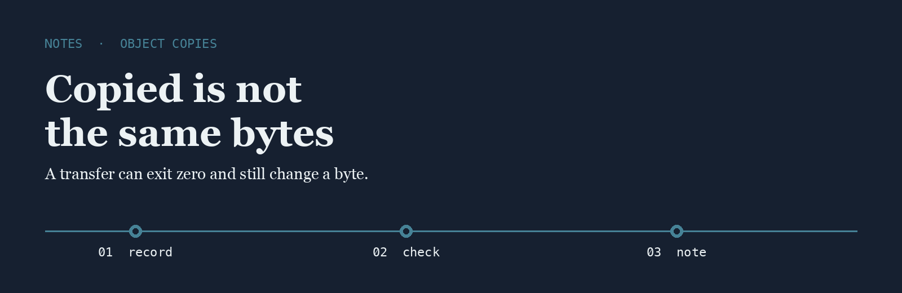
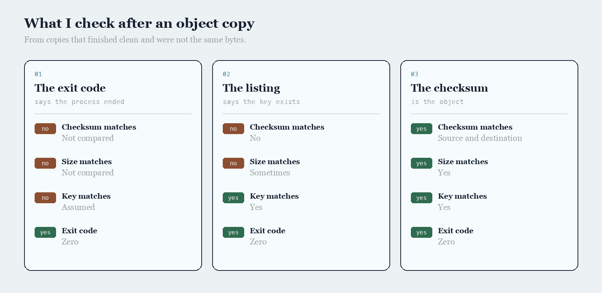

<p align="center">
  
</p>

# Nadia Keller

I copy objects between buckets and then I compare the checksum the destination stored with the one I computed before the copy.

## The question

After the copy command exited zero, did you compare checksums, or trust the exit code?

<p align="center">
  
</p>

|  | The exit code | The listing | The checksum |
| --- | --- | --- | --- |
| Checksum matches | Not compared | No | Source and destination |
| Size matches | Not compared | Sometimes | Yes |
| Key matches | Assumed | Yes | Yes |
| Exit code | Zero | Zero | Zero |

## The line I keep

The line I write when the checksums agree.

```text
2026-06-09  copy  s3://exports/day-161  size 4821934412  sha256 match  tool rclone
```

Finishing the transfer is solved. Proving the destination bytes match is not.

- [rclone](https://github.com/rclone/rclone) is the copy tool I check with a checksum flag
- [s5cmd](https://github.com/peak/s5cmd) is the fast copy I use when the bucket is large
- [minio](https://github.com/minio/minio) is the store I read when a checksum header looks wrong

I keep a fork of each on this account.

## What I pay attention to

- Checksums compared after the copy
- Sizes that match the source
- Keys that name the day
- A second tool when one copy looks too fast

## Working with me

Send a short problem statement, a way to see it happen, and what done looks like. I am independent, remote, and usually around during the Helsinki afternoon.
